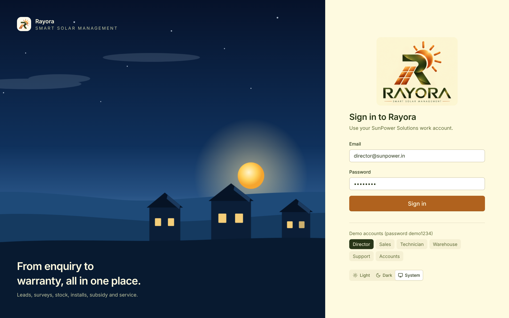
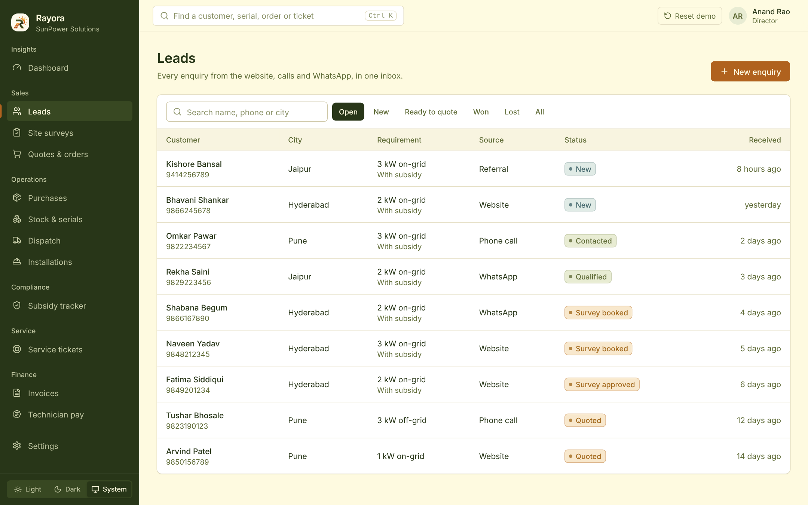
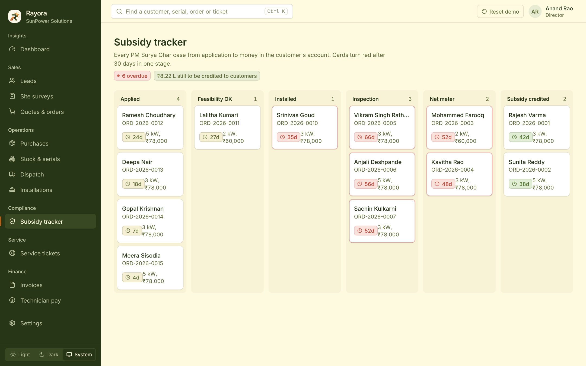

<div align="center">


# Rayora

### Smart solar management, from first enquiry to a 20-year warranty

**Subsidy-ready by design &nbsp;·&nbsp; Every serial traced &nbsp;·&nbsp; Profit on every job**

<br />

[](https://rayora.onrender.com)


<br />

<a href="#-the-problem">Problem</a> &nbsp;•&nbsp;
<a href="#-features">Features</a> &nbsp;•&nbsp;
<a href="#-screenshots">Screenshots</a> &nbsp;•&nbsp;
<a href="#-getting-started">Getting started</a> &nbsp;•&nbsp;
<a href="#-architecture">Architecture</a> &nbsp;•&nbsp;
<a href="#-built-for-real-world-load">Reliability</a>

<br /><br />


</div>

<br />

## 🌞 The problem

Rooftop solar installers in India run on WhatsApp chats, spreadsheets and paper. That costs them in three places:

<table>
<tr>
<td width="33%" valign="top" align="center">
<h3>📄</h3>
<b>Rejected subsidy claims</b>
<br /><br />
PM Surya Ghar claims are rejected for avoidable mistakes: photos without GPS, non-DCR panels, missing serials, names that don't match, installing before DISCOM approval.
</td>
<td width="33%" valign="top" align="center">
<h3>🔍</h3>
<b>Lost traceability</b>
<br /><br />
Nobody knows which inverter went to which roof, so warranty claims turn into arguments and stock goes missing.
</td>
<td width="33%" valign="top" align="center">
<h3>💸</h3>
<b>Invisible losses</b>
<br /><br />
Discounts, labour and free repairs quietly eat margins. Owners can't see which jobs actually made money.
</td>
</tr>
</table>

<div align="center">

**Rayora replaces all of it with one system, and turns each of those mistakes into a rule the software enforces.**

</div>

<br />

## ✨ Features

<div align="center">

| | Module | What it does |
|:-:|---|---|
| 📥 | **Leads** | Web, call and WhatsApp enquiries in one inbox. Returning customers are recognised by phone number. Subsidy readiness is checked up front. |
| 📐 | **Site surveys** | Roof direction, tilt, shade and cable run. **No quote until the survey is approved.** |
| 🧾 | **Quotes** | Pick a kit and every part fills in. A payback card shows savings, subsidy and years to break even. Non-DCR panels are **blocked** on subsidy orders. |
| ✅ | **One-click confirm** | A single transaction reserves the exact serials and creates the pick list, crew job, invoice and subsidy case. All or nothing. |
| 📦 | **Stock & purchases** | Every unit is received with its serial number. Low stock is flagged with **one-click reorders** grouped by supplier. |
| 🚚 | **Dispatch scanner** | Only serials reserved for *this* order are accepted. Duplicates are refused. Nothing leaves until everything is scanned. |
| 🛡️ | **Warranty** | Starts automatically on delivery (2 years inverters, 20 years panels). A QR sticker is generated for every unit. |
| 🔧 | **Installation app** | A phone-first flow: serials, GPS-tagged photos, customer signature. Drafts are saved on the device, so a weak rooftop signal loses nothing. |
| 📜 | **Handover certificate** | A printable commissioning certificate with every serial, its warranty end date, photos and the customer's signature. |
| 🏛️ | **Subsidy tracker** | A board from application to money credited, with days in each stage. **Inspection gate:** submission stays locked until every check passes. |
| 📍 | **Customer tracking** | A public, signed link where customers follow their order like a delivery, including the subsidy steps. |
| 🎫 | **Service tickets** | Customers scan the QR sticker to report a fault. Warranty decides free or billable. Every repair has a 15-day deadline. |
| 💰 | **Finance** | Invoices with safe payments (no double charges, no overpaying). Technician pay from logged hours; a month can't be paid twice. |
| 📊 | **Dashboard** | Profit on every job from the exact cost of each serial used, plus labour and repairs. Money blocked by subsidy delays. Export, print, or share a read-only link. |

</div>

<br />

### 🏛️ The subsidy inspection gate

<div align="center">

A file can't be submitted for inspection until **all seven checks** pass:

| | Check |
|:-:|---|
| ✔️ | Names match on Aadhaar, electricity bill and bank account |
| ✔️ | Every panel is DCR (made in India) |
| ✔️ | Every panel and inverter serial is recorded |
| ✔️ | Every required photo is GPS-tagged and timestamped |
| ✔️ | Installed capacity is within the sanctioned capacity |
| ✔️ | DISCOM feasibility was approved before installation started |
| ✔️ | The customer signed the installation report |

</div>

<br />

## 📸 Screenshots

<div align="center">

<h3>Sign in</h3>


<br /><br />

<h3>Leads and subsidy readiness</h3>
<p>Every enquiry in one inbox. Name mismatches are flagged <i>before</i> the sale.</p>



<br /><br />

<h3>Quotes with payback</h3>
<p>Kit-based quotes with a savings estimate. Confirming creates the pick list, job, invoice and subsidy case automatically.</p>


<br /><br />

<h3>Stock, reorders and dispatch</h3>
<p>Low stock reordered in one click. The scanner refuses duplicate and wrong serials.</p>


<br /><br />

<h3>Installations</h3>
<p>Jobs can't start before DISCOM feasibility approval. Technicians complete them on their phones.</p>


<br /><br />

<h3>Subsidy tracker and inspection gate</h3>



<br /><br />

<h3>Handover certificate</h3>


<br /><br />

<h3>Service tickets</h3>
<p>Every repair has a 15-day deadline. Warranty decides free or billable.</p>


<br /><br />

<h3>On the phone</h3>

<table>
<tr>
<td align="center"><br /><sub><b>Technician install flow</b></sub></td>
<td align="center"><br /><sub><b>Customer order tracking</b></sub></td>
<td align="center"><br /><sub><b>QR sticker warranty page</b></sub></td>
</tr>
</table>

<br />

<h3>Light and dark</h3>


</div>

<br />

## 🚀 Getting started

### Try it online

<div align="center">

**[rayora.onrender.com](https://rayora.onrender.com)**

<sub>Free hosting sleeps when idle, so the first visit can take about a minute. Demo data resets on every restart.</sub>

</div>

### Demo logins

<div align="center">

All passwords: **`demo1234`**

| Role | Email | Lands on |
|---|---|---|
| 👔 Director | `director@sunpower.in` | Dashboard (sees everything) |
| 💼 Sales | `priya@sunpower.in` | Leads |
| 🔧 Technician | `ravi@sunpower.in` | Installations |
| 📦 Warehouse | `warehouse@sunpower.in` | Dispatch |
| 🎧 Support | `support@sunpower.in` | Service tickets |
| 🧮 Accounts | `accounts@sunpower.in` | Invoices |

</div>

**Public pages (no login):** `/enquiry` (website form) · `/u/legacy-demo-unit-0007` (QR page of an out-of-warranty inverter) · `/track/<code>` (customer tracking) · `/shared/<token>` (shared report)

### Run it locally

**Requirements:** Python 3.11+, Node 20+, PostgreSQL 16 (or Docker)

**1. Database**

```bash
docker compose up -d
```

<details>
<summary>Using a local PostgreSQL instead of Docker</summary>

```bash
psql postgres -c "CREATE USER suryaops WITH PASSWORD 'suryaops' CREATEDB;"
psql postgres -c "CREATE DATABASE suryaops OWNER suryaops;"
```

</details>

**2. Backend** (in one terminal)

```bash
cd backend
python -m venv .venv && source .venv/bin/activate
pip install -r requirements.txt
cp .env.example .env              # then set a long random JWT_SECRET
alembic upgrade head              # create the tables
python -m app.seed.seed           # load the demo data
uvicorn app.main:app --reload --port 8000
```

**3. Frontend** (in a second terminal)

```bash
cd frontend
npm install
npm run dev
```

Open **http://localhost:5173**. API docs are at **http://localhost:8000/docs**.

**Reset the demo data** at any time with `python -m app.seed.seed --reset`, or the **Reset demo** button in the top bar when signed in as Director.

### Run the tests

```bash
cd backend && pytest -q
```

<details>
<summary>What the 15 tests cover</summary>

Quote blocked without an approved survey · non-DCR panels refused in subsidy orders · stock rollback when confirmation fails · two people reserving the same stock at once · duplicate serials refused · warranty dates from delivery · technician double-booking refused · payment idempotency and overpayment · the inspection gate · feasibility before installation · free vs billable repairs · pay runs · role-based access · the public QR page

</details>

<br />

## 🏗️ Architecture

<div align="center">

```
┌───────────────────────┐        ┌───────────────────────────────┐        ┌───────────────────────┐
│    React + Vite       │  JSON  │            FastAPI            │  SQL   │     PostgreSQL 16     │
│                       │ ─────► │                               │ ─────► │                       │
│  Staff app (6 roles)  │  JWT   │  routers → services → ORM     │        │  constraints, locks   │
│  Public pages         │        │  role checks · rate limits    │        │  sequences, indexes   │
│  Light / dark themes  │        │  one error format             │        │                       │
└───────────────────────┘        └───────────────────────────────┘        └───────────────────────┘
```

</div>

<div align="center">

| Layer | Technology | Why |
|---|---|---|
| **Frontend** | React 18, TypeScript (strict), Vite | Fast, type-safe UI with route-level code splitting |
| **Styling** | Tailwind CSS with CSS-variable design tokens | One palette, two themes, consistent everywhere |
| **Data fetching** | TanStack Query | Caching, background refresh and smart retries |
| **UI parts** | Radix UI, Recharts, lucide icons, sonner, signature_pad | Accessible dialogs and menus, charts, signatures |
| **Backend** | FastAPI, Pydantic v2 | Typed, validated, self-documenting API |
| **Database** | PostgreSQL 16, SQLAlchemy 2.0, Alembic | Transactions, row locks and constraints as the last line of defence |
| **Security** | JWT, bcrypt, slowapi | Role checks on every route, rate-limited public endpoints |
| **Deployment** | Docker, Render | One container serves the API and the app from a single URL |

</div>

<details>
<summary><b>Project layout</b></summary>

```
backend/
  app/core/        config, database, security, errors, logging, rate limits, role checks
  app/models/      database tables, one file per area
  app/schemas/     request validation
  app/services/    all business rules and transactions
  app/routers/     HTTP endpoints only
  app/seed/        realistic demo data, generated through the real services
  alembic/         database migrations
  tests/           tests for the critical rules
frontend/
  src/styles/      design tokens (light and dark)
  src/lib/         API client, auth, theme, formatting, hooks
  src/components/  UI kit and shared parts (shell, tables, stepper, search, capture)
  src/features/    one file per area of the app
docs/screenshots/  images used in this README
```

</details>

<br />

## 🛡️ Built for real-world load

<table>
<tr>
<td width="50%" valign="top">

**⚡ Concurrency**
- Every multi-step action runs in one transaction
- Stock is reserved with `SELECT … FOR UPDATE SKIP LOCKED`
- Version columns stop silent overwrites; stale edits get a clear message

**💳 Money safety**
- Idempotency keys on order confirmation and payments
- `CHECK (amount_paid <= total)` in the database
- Pay runs are unique per technician per month

**🗄️ The database as the last line of defence**
- Unique serials, phone numbers and document numbers
- Stock can't go negative; time ranges must be valid

</td>
<td width="50%" valign="top">

**📈 Scale**
- Server-side pagination, filtering and search
- Indexes on the busiest queries
- SQL aggregates with a dashboard cache that clears on every write
- Connection pooling, GZip, code splitting

**🔁 Resilience**
- One error format with request IDs, JSON logs, health check
- "Connection lost" banner with automatic retry
- Install drafts saved on the device; per-photo upload retry
- Photos compressed on the phone before upload

**🔐 Security**
- bcrypt passwords, JWT sessions, role checks on every request
- Technicians only ever see their own jobs
- Public pages show masked names; share links expire and can be revoked

</td>
</tr>
</table>

<br />

## 📚 Documentation

<div align="center">

| Document | What's inside |
|---|---|
| [**DOCUMENTATION.md**](DOCUMENTATION.md) | Full guide: setup, every module, business rules, API, troubleshooting |
| [**spec.md**](spec.md) | Product and technical specification |
| [**API reference**](http://localhost:8000/docs) | Interactive docs, available while the backend is running |

</div>

<br />

---

<div align="center">


**Rayora** · Smart Solar Management

<sub>Built in 24 hours for SunPower Solutions · Made with ☀️</sub>

</div>