<div align="center">

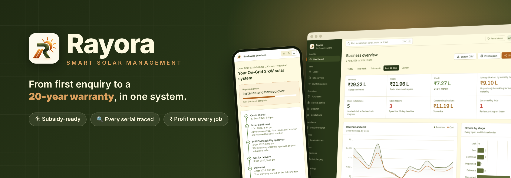

<br /><br />

[](https://rayora.onrender.com)
&nbsp;
[](DOCUMENTATION.md)


<br />

**[The problem](#-the-problem)** &nbsp;·&nbsp;
**[How it works](#-how-it-works)** &nbsp;·&nbsp;
**[Features](#-features)** &nbsp;·&nbsp;
**[Screenshots](#-screenshots)** &nbsp;·&nbsp;
**[Try it](#-try-it)** &nbsp;·&nbsp;
**[Tech](#%EF%B8%8F-architecture)** &nbsp;·&nbsp;
**[Reliability](#%EF%B8%8F-built-for-real-world-load)**

</div>

<br />

<table>
<tr>
<td align="center" width="20%"><h2>13</h2><sub>modules, one system</sub></td>
<td align="center" width="20%"><h2>7</h2><sub>subsidy checks before submission</sub></td>
<td align="center" width="20%"><h2>6 + 1</h2><sub>staff roles plus a customer view</sub></td>
<td align="center" width="20%"><h2>100%</h2><sub>of panels and inverters tracked by serial</sub></td>
<td align="center" width="20%"><h2>15</h2><sub>automated tests on critical rules</sub></td>
</tr>
</table>

<br />

## 🌞 The problem

Rooftop solar is booming in India under **PM Surya Ghar**, but most installers still run on WhatsApp chats, spreadsheets and paper. That costs them in three places:

<table>
<tr>
<td width="33%" valign="top">

### 📄 Rejected subsidies
Claims are rejected for avoidable mistakes: photos without GPS, non-DCR panels, missing serials, names that don't match, installing before DISCOM approval.

</td>
<td width="33%" valign="top">

### 🔍 Lost traceability
Nobody knows which inverter went on which roof, so warranty claims turn into arguments and stock quietly goes missing.

</td>
<td width="33%" valign="top">

### 💸 Invisible losses
Discounts, labour and free repairs eat margins. Owners can't see which jobs actually made money.

</td>
</tr>
</table>

<div align="center">
<br />

> **Rayora replaces all of it with one system, and turns each of those mistakes into a rule the software enforces.**

</div>

<br />

## 🔄 How it works

One customer, one record, from the first enquiry to year twenty:

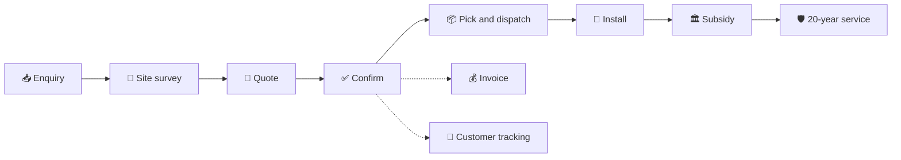

<br />

## ✨ Features

<table>
<tr>
<td width="33%" valign="top">

#### 🌐 Customer website
Savings calculator, how-it-works, FAQ. Every button leads to the enquiry form, pre-filled with the suggested system size.

</td>
<td width="33%" valign="top">

#### 📥 Leads
Website, call and WhatsApp enquiries in one inbox. Returning customers are recognised by phone. **Name mismatches are flagged before the sale.**

</td>
<td width="33%" valign="top">

#### 🧾 Quotes
Pick a kit and every part fills in, with a payback card. **No quote without an approved survey. Non-DCR panels blocked** on subsidy orders.

</td>
</tr>
<tr>
<td valign="top">

#### ✅ One-click confirm
A single transaction reserves the exact serials and creates the pick list, crew job, invoice and subsidy case. **All or nothing.**

</td>
<td valign="top">

#### 📦 Stock and dispatch
Serials recorded on receipt, duplicates refused. **One-click reorders** for low stock. The scanner refuses wrong or duplicate units.

</td>
<td valign="top">

#### 🔧 Installation app
Phone-first: serials, **GPS-tagged photos**, customer signature. Drafts saved on the device. **No start before DISCOM approval, no double-booking.**

</td>
</tr>
<tr>
<td valign="top">

#### 🏛️ Subsidy tracker
A board from application to money credited, with days in each stage. **Submission locked until all 7 checks pass.**

</td>
<td valign="top">

#### 📍 Tracking and certificate
Customers follow their order through a **signed link**. A printable **handover certificate** lists every serial and its warranty end date.

</td>
<td valign="top">

#### 🎫 Service tickets
Customers **scan a QR sticker** to report a fault. Warranty decides free or billable. **15-day deadline**, GPS proof of every fix.

</td>
</tr>
<tr>
<td valign="top">

#### 💰 Finance
Invoices with safe payments: **no double charges, no overpaying.** Technician pay from logged hours; a month can't be paid twice.

</td>
<td valign="top">

#### 📊 Dashboard
**Profit on every job** from the exact cost of each serial, plus labour and repairs. Money blocked by subsidy delays.

</td>
<td valign="top">

#### 📤 Sharing
Export CSV, print to PDF, or share an **expiring read-only link** with no personal data. Light and dark themes throughout.

</td>
</tr>
</table>

<br />

<details>
<summary><b>🏛️ The 7-point subsidy inspection gate</b></summary>
<br />

| | Check |
|:-:|---|
| ✔️ | Names match on Aadhaar, electricity bill and bank account |
| ✔️ | Every panel is DCR (made in India) |
| ✔️ | Every panel and inverter serial is recorded |
| ✔️ | Every required photo is GPS-tagged and timestamped |
| ✔️ | Installed capacity is within the sanctioned capacity |
| ✔️ | DISCOM feasibility was approved before installation started |
| ✔️ | The customer signed the installation report |

</details>

<br />

## 📸 Screenshots

<div align="center">

### The customer's first impression
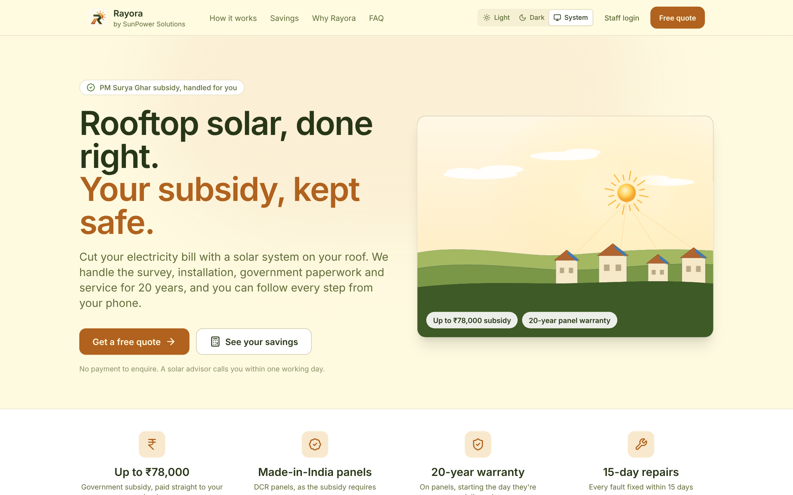
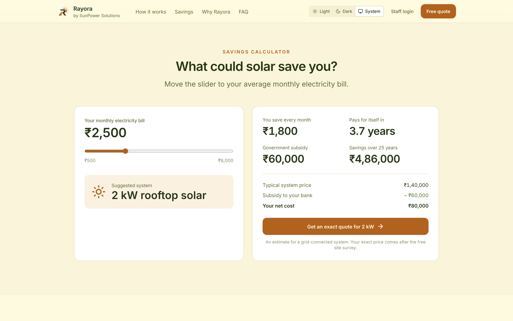
<sub>The public website and its savings calculator. One tap opens a pre-filled enquiry.</sub>

<br /><br />

### The owner's morning view
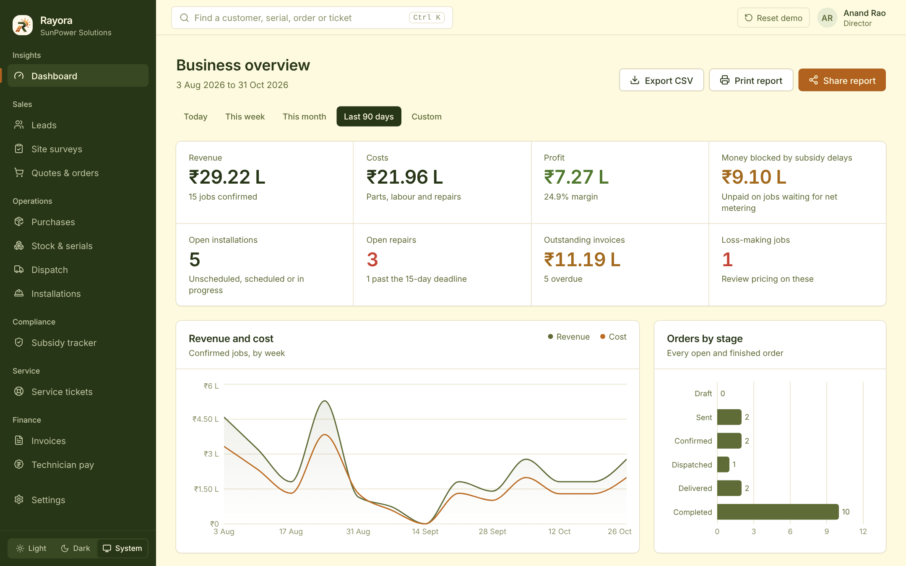
<sub>Revenue, profit per job, money blocked by subsidy delays, repairs near deadline.</sub>

</div>

<br />

<table>
<tr>
<td width="50%" align="center">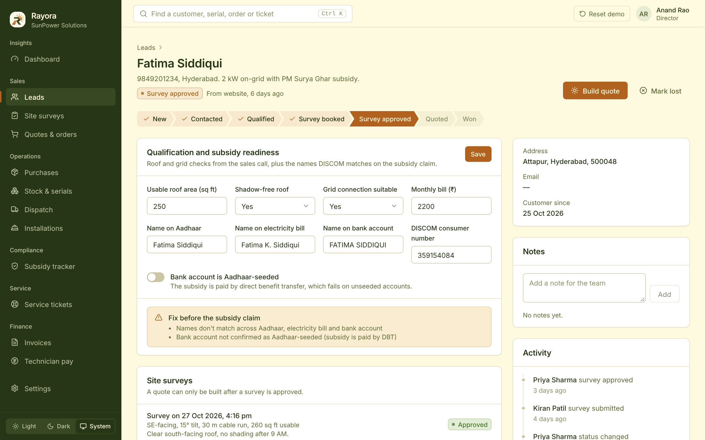<br /><b>Subsidy readiness</b><br /><sub>Name mismatches caught before the sale</sub></td>
<td width="50%" align="center">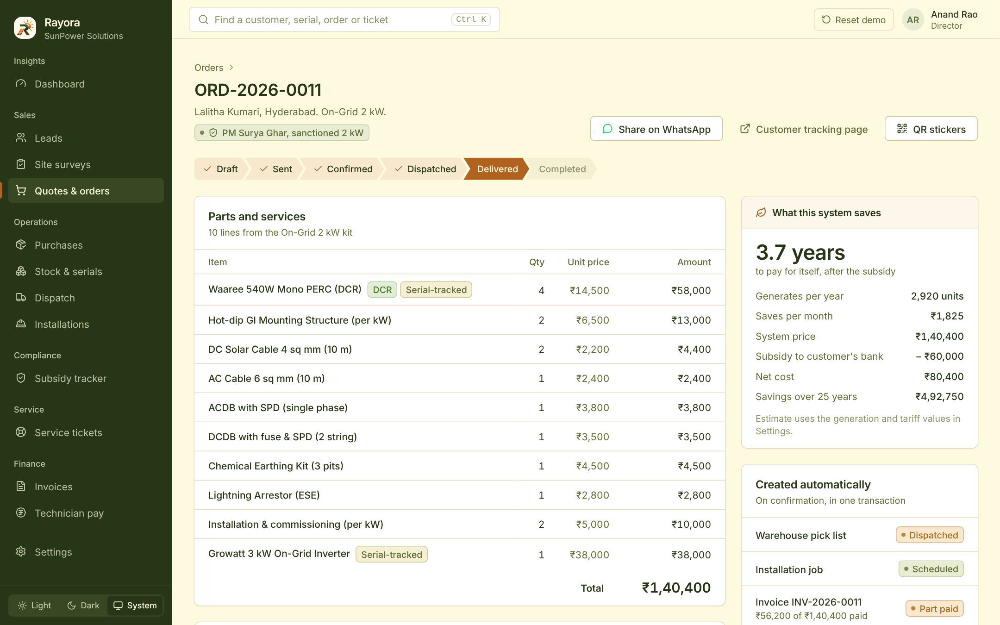<br /><b>Quote with payback</b><br /><sub>Every part listed, subsidy and savings worked out</sub></td>
</tr>
<tr>
<td align="center">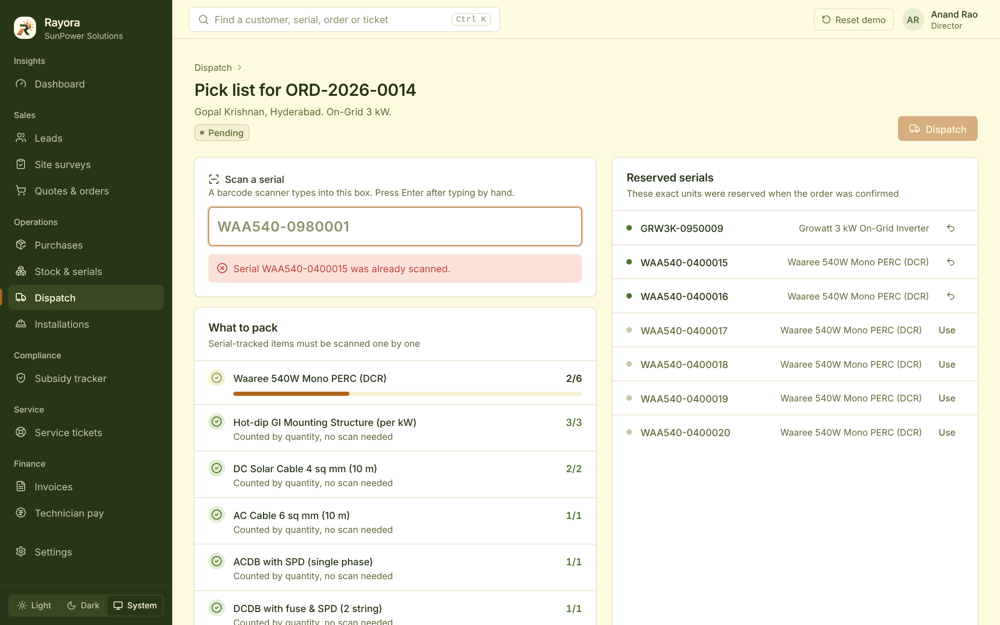<br /><b>Dispatch scanner</b><br /><sub>Duplicate and wrong serials refused</sub></td>
<td align="center">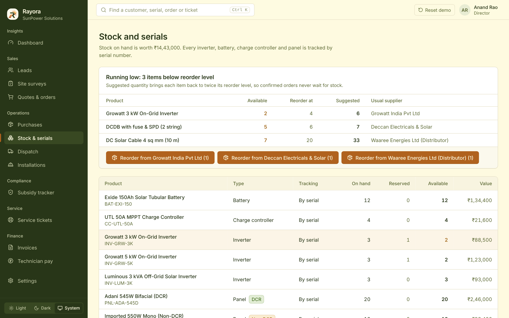<br /><b>Reorder suggestions</b><br /><sub>Low stock reordered in one click, by supplier</sub></td>
</tr>
<tr>
<td align="center">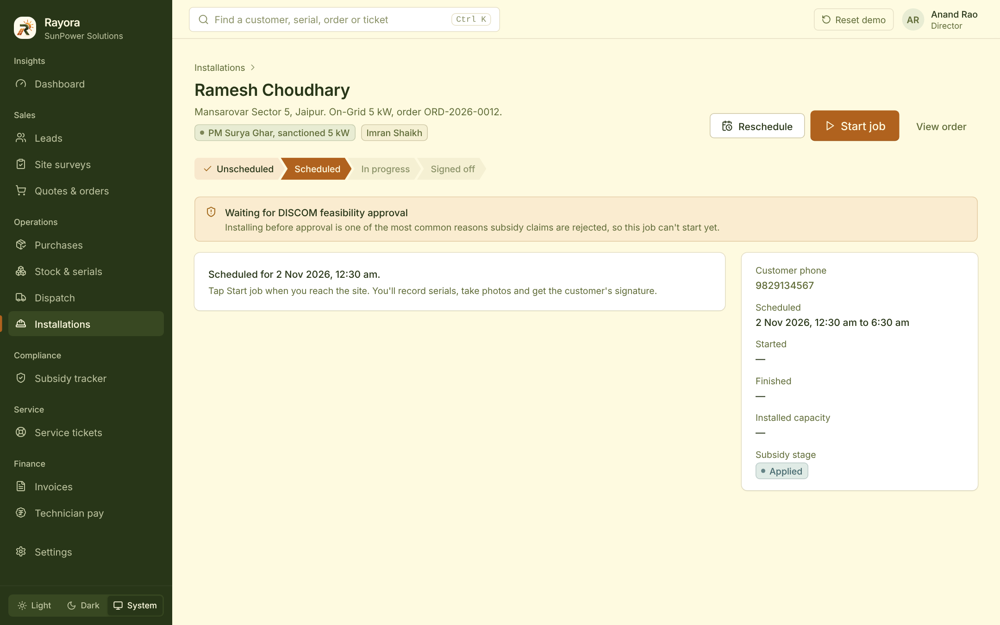<br /><b>Approval before install</b><br /><sub>Jobs can't start before DISCOM feasibility</sub></td>
<td align="center">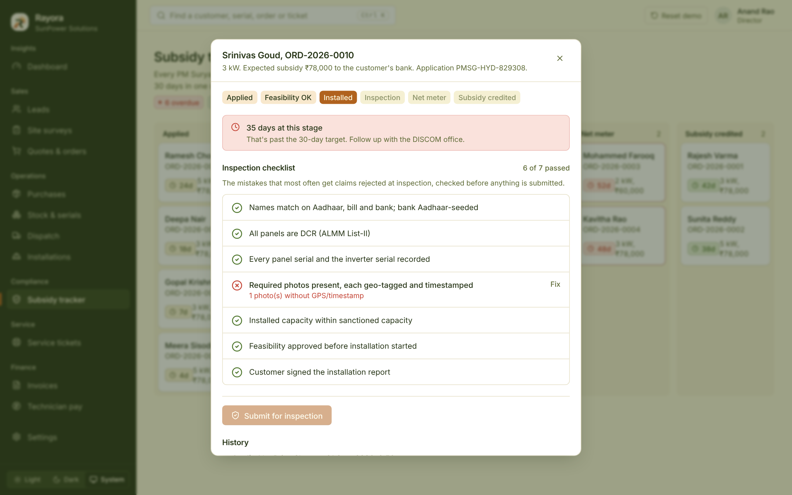<br /><b>Inspection gate</b><br /><sub>A photo without GPS keeps submission locked</sub></td>
</tr>
<tr>
<td align="center">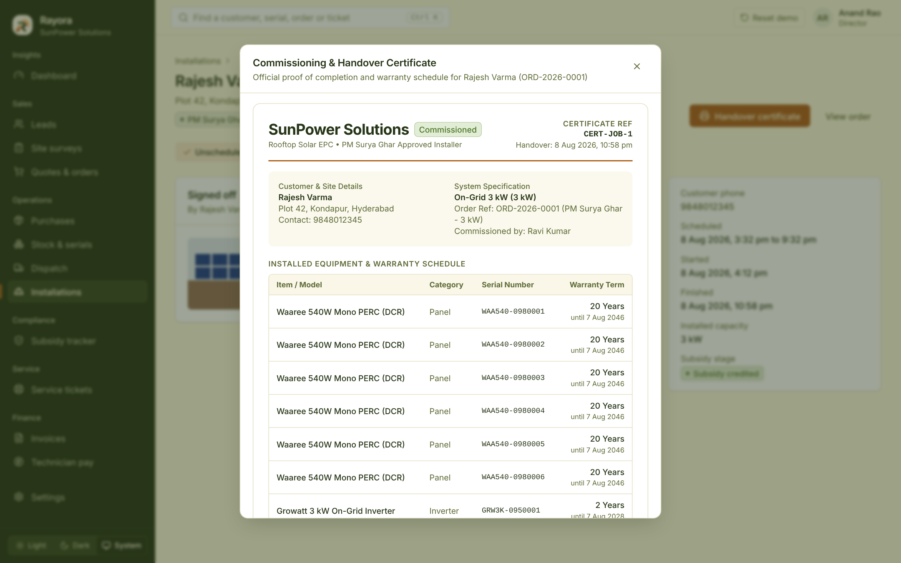<br /><b>Handover certificate</b><br /><sub>Every serial with its real warranty end date</sub></td>
<td align="center">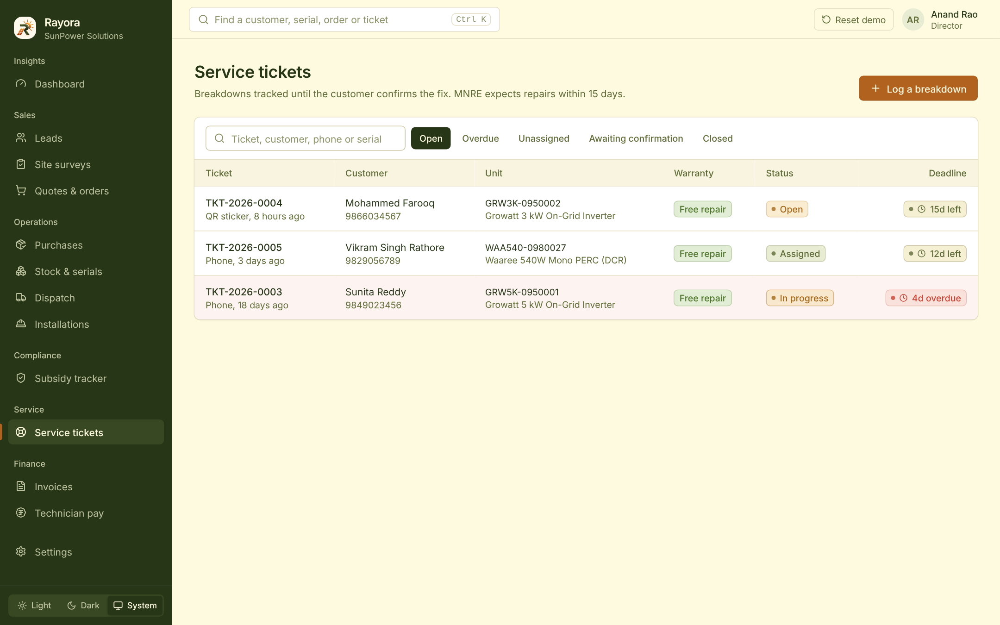<br /><b>Service tickets</b><br /><sub>15-day deadlines, free or billable by warranty</sub></td>
</tr>
</table>

<div align="center">

### On the phone

<table>
<tr>
<td align="center">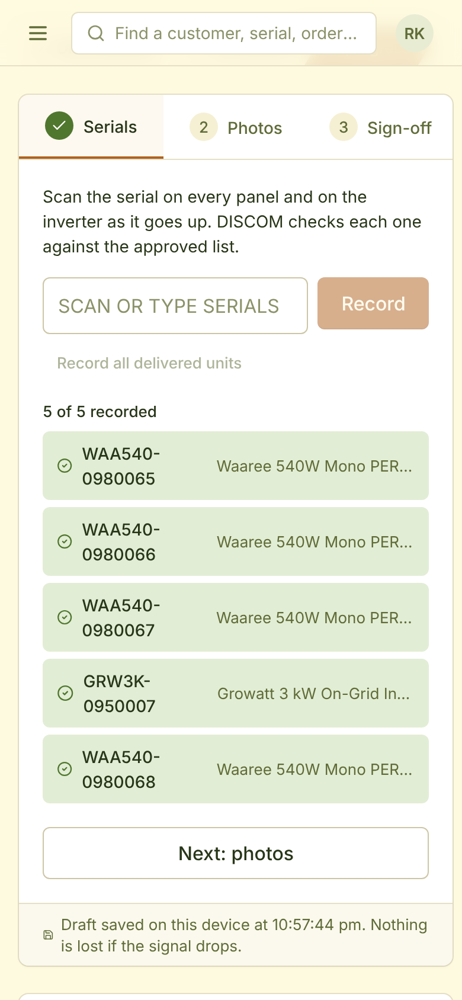<br /><b>Technician</b><br /><sub>Serials, GPS photos, signature</sub></td>
<td align="center">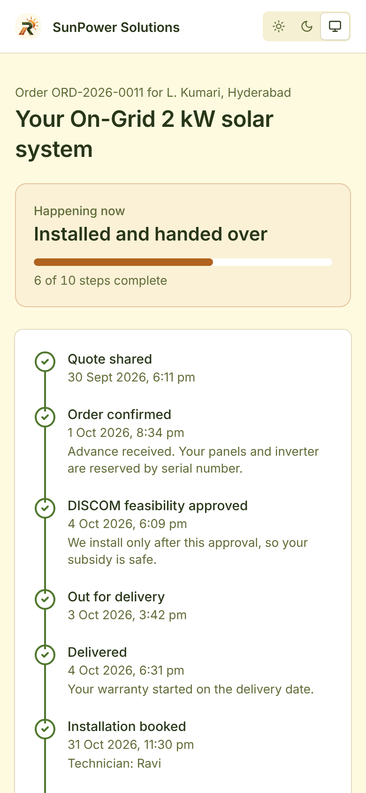<br /><b>Customer tracking</b><br /><sub>Every step, like a delivery</sub></td>
<td align="center">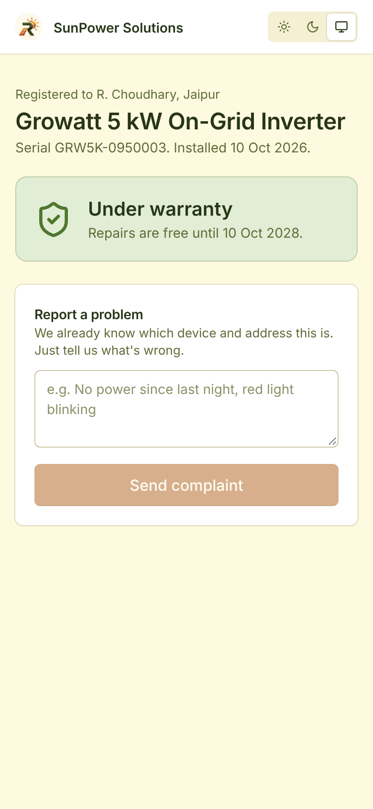<br /><b>QR sticker</b><br /><sub>Warranty status and one-tap complaints</sub></td>
</tr>
</table>

### Light and dark

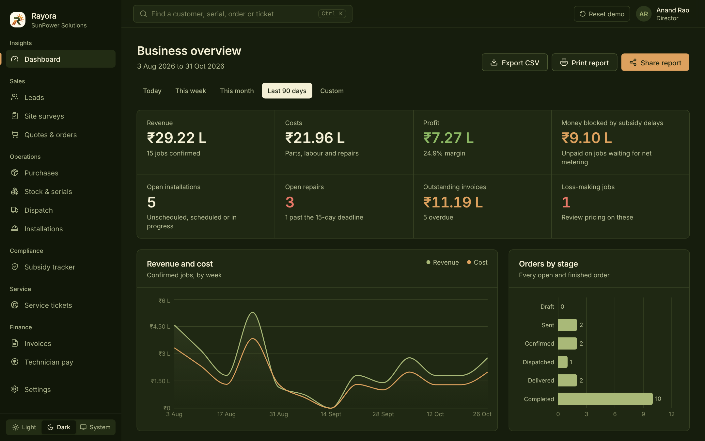

</div>

<br />

## 🚀 Try it

<div align="center">

### **[▶ rayora.onrender.com](https://rayora.onrender.com)**
<sub>Free hosting sleeps when idle, so the first visit can take about a minute. Demo data resets on every restart.</sub>

<br />

| Role | Email | Lands on |
|---|---|---|
| 👔 **Director** | `director@sunpower.in` | Dashboard (sees everything) |
| 💼 Sales | `priya@sunpower.in` | Leads |
| 🔧 Technician | `ravi@sunpower.in` | Installations |
| 📦 Warehouse | `warehouse@sunpower.in` | Dispatch |
| 🎧 Support | `support@sunpower.in` | Service tickets |
| 🧮 Accounts | `accounts@sunpower.in` | Invoices |
| 🏠 **Customer** | *no login* | The website at `/`, or **Customer ↗** on the login page |

All staff passwords: **`demo1234`**

</div>

<details>
<summary><b>🔗 Public pages (no login)</b></summary>
<br />

| Page | What it is |
|---|---|
| `/` | Customer website with savings calculator |
| `/enquiry` | Enquiry form |
| `/track/<code>` | Customer order tracking (signed link) |
| `/u/legacy-demo-unit-0007` | QR page of an out-of-warranty inverter |
| `/shared/<token>` | Read-only shared report |

</details>

<details>
<summary><b>🎬 A 5-minute demo path</b></summary>
<br />

1. Open the **customer website**, use the savings calculator, and send an enquiry.
2. Sign in as **Director** and find it in **Leads**. Open **Shabana Begum**: quoting is blocked without an approved survey.
3. Open **Fatima Siddiqui**: her names don't match. Build a 2 kW quote, try adding a non-DCR panel (blocked), then **Confirm**.
4. Open the **customer tracking page** for her order.
5. **Dispatch** → Gopal Krishnan: scan `WAA540-0400015` twice. The second scan is refused.
6. **Subsidy tracker** → Srinivas Goud: a photo without GPS keeps submission locked.
7. **Dashboard**: ORD-2026-0007 shows a loss. Switch to dark theme.

Click **Reset demo** in the top bar to start again.

</details>

### Run it locally

**Requirements:** Python 3.11+, Node 20+, PostgreSQL 16 (or Docker)

```bash
# 1. Database (or use a local PostgreSQL, see DOCUMENTATION.md)
docker compose up -d

# 2. Backend (terminal 1)
cd backend
python -m venv .venv && source .venv/bin/activate     # Windows: .venv\Scripts\activate
pip install -r requirements.txt
cp .env.example .env                                    # then set a long random JWT_SECRET
alembic upgrade head
python -m app.seed.seed
uvicorn app.main:app --reload --port 8000

# 3. Frontend (terminal 2)
cd frontend
npm install
npm run dev
```

Open **http://localhost:5173**. Interactive API docs are at **/docs** on the backend (port 8000).

<details>
<summary><b>🧪 Tests</b></summary>
<br />

```bash
cd backend && pytest -q
```

The 15 tests cover: quote blocked without an approved survey · non-DCR panels refused in subsidy orders · stock rollback on failure · two people reserving the same stock at once · duplicate serials refused · warranty dates from delivery · technician double-booking · payment idempotency and overpayment · the inspection gate · feasibility before installation · free vs billable repairs · pay runs · role-based access · the public QR page

</details>

<br />

## 🏗️ Architecture

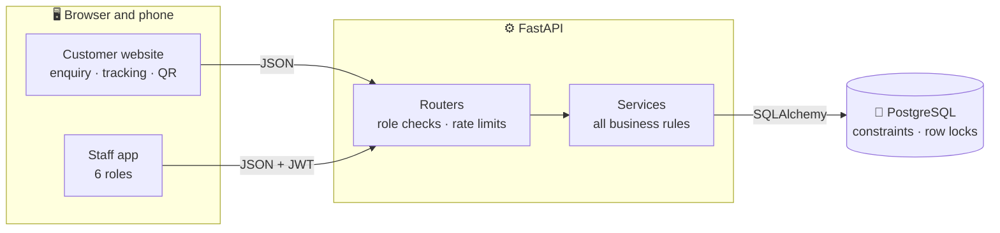

| Layer | Technology | Why |
|---|---|---|
| **Frontend** | React 18, TypeScript (strict), Vite | Fast, type-safe UI with page-level code splitting |
| **Styling** | Tailwind CSS with CSS-variable design tokens | One palette, two themes, consistent everywhere |
| **Data** | TanStack Query, React Router | Caching, background refresh, smart retries, role-guarded routes |
| **UI parts** | Radix UI, Recharts, lucide, sonner, signature_pad | Accessible dialogs, charts, icons, toasts, signatures |
| **Backend** | FastAPI, Pydantic v2 | Typed, validated, self-documenting API |
| **Database** | PostgreSQL 16, SQLAlchemy 2.0, Alembic | Transactions, row locks and constraints as the last line of defence |
| **Security** | JWT, bcrypt, slowapi, HMAC-signed links | Role checks on every request, rate-limited public pages |
| **Deployment** | Docker (multi-stage), Render | One container serves the API and the app from a single URL |

<details>
<summary><b>📁 Project layout</b></summary>
<br />

```
backend/
  app/core/        config, database, security, errors, logging, rate limits, role checks
  app/models/      database tables, one file per area
  app/schemas/     request validation
  app/services/    all business rules and transactions
  app/routers/     HTTP endpoints only
  app/seed/        realistic demo data, generated through the real services
  alembic/         database migrations
  tests/           tests for the critical rules
frontend/
  src/features/    one file per area of the app, plus the customer website
  src/components/  UI kit and shared parts (shell, tables, stepper, search, capture)
  src/lib/         API client, auth, theme, formatting, hooks
  src/styles/      design tokens (light and dark)
docs/              banner and screenshots for this README
```

</details>

<br />

## 🛡️ Built for real-world load

<table>
<tr>
<td width="50%" valign="top">

**⚡ Concurrency**
- Every multi-step action runs in one transaction
- Stock reserved with `SELECT … FOR UPDATE SKIP LOCKED`
- Version columns stop silent overwrites

**💳 Money safety**
- Idempotency keys on confirmation and payments
- `CHECK (amount_paid <= total)` in the database
- One pay run per technician per month

**🗄️ Database as the last line of defence**
- Unique serials, phones and document numbers
- Stock can't go negative; time ranges must be valid

</td>
<td width="50%" valign="top">

**📈 Scale**
- Server-side pagination, filtering and search
- Indexes on the busiest queries
- SQL aggregates with a cache that clears on every write
- Connection pooling, GZip, code splitting

**🔁 Resilience**
- One error format with request IDs; JSON logs
- "Connection lost" banner with automatic retry
- Install drafts saved on the device; photo retry

**🔐 Security**
- bcrypt passwords, JWT sessions, server-side role checks
- Technicians only ever see their own jobs
- Masked names on public pages; share links expire

</td>
</tr>
</table>

<br />

## 📚 Documentation

<div align="center">

| | Document | What's inside |
|:-:|---|---|
| 📖 | [**DOCUMENTATION.md**](DOCUMENTATION.md) | Setup, every module, business rules, API, troubleshooting |
| 📋 | [**spec.md**](spec.md) | Product and technical specification |
| ⚙️ | **`/docs`** on the running backend | Interactive API reference |

</div>

<br />

---

<div align="center">


**Rayora** · Smart Solar Management

<sub>Built in 24 hours for SunPower Solutions · Made with ☀️</sub>

</div>